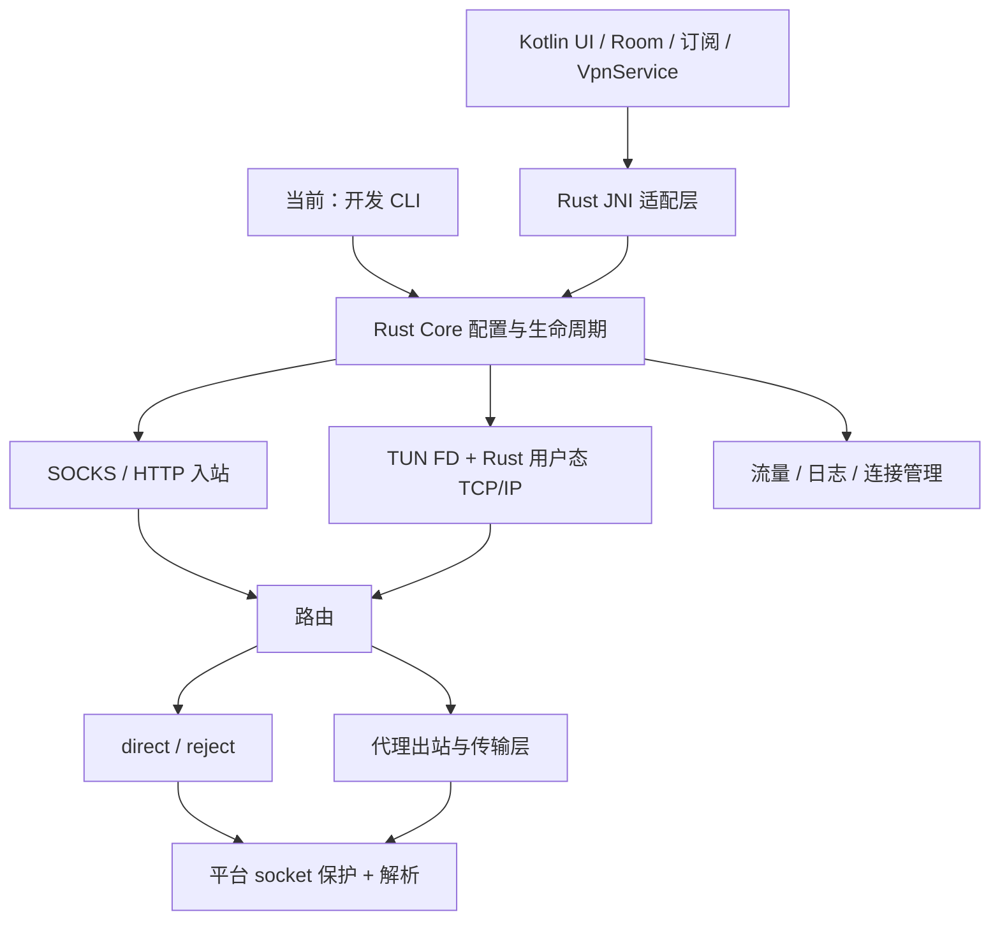

# AeroBox Android → Rust 内核设计

基准：本地 `/home/Code/AeroBoxForAndroid`，HEAD `7206146effd0ac3602eb5b96ad5986e5af5ced5e`；检查日期 2026-11-20。Android 固定的 sing-box 版本为 `v1.14.4`。本文区分“Android 现有配置能力”“Rust 当前实现”和“后续目标”，不把解析字段或编译成功等同于协议互通。

当前进度：2026-11-26 已完成模拟器上的 SOCKS/TUN TCP/UDP、DNS、IPv4/IPv6 FakeIP、分应用、启停与短暂 Wi-Fi 中断恢复验证，见 [设备记录](android-network-validation.md)。运行时代码已扩展至全部协议家族，但高级选项和互操作验收尚未全部完成。最新工程入口见根 README；以下协议矩阵与阶段表用于跟踪完整目标，不代表所有阶段已交付。

用户选择的推进方式：先完成基础内核，再按 Android 的全部协议分阶段实现。项目创建阶段直接使用当前接口，不维护旧版本兼容层。当前直接在原 Android 工程 `/home/Code/AeroBoxForAndroid` 的 `rust` 分支开发。

## 结论与纯 Rust 边界

可把 Android 的 Kotlin UI、Room、订阅、后台任务及 VpnService 保留，将 Go/libbox 的网络数据平面逐步替换成 Rust。主要工作不只是重写 11 类节点的配置，还包括 UDP、TLS/QUIC、用户态 TCP/IP、DNS/分流、平台回调以及原有 libbox 定制补丁的行为。

本项目将“纯 Rust”理解为：代理协议、传输、用户态网络栈及密码实现使用 Rust，不内嵌 Go runtime、C/C++ 代理内核、Cronet 或 lwIP。Android JNI、系统 socket、随机数及系统 API 仍通过操作系统接口使用。TLS/QUIC 已接入自有 RustCrypto 提供者，密码依赖与最终产物单独验收。

`rustls` 提供可替换的密码提供者接口；默认配置并不能证明整个依赖树都为纯 Rust。后续应关闭不符合要求的默认功能，显式选择符合目标的提供者，并检查最终依赖树及链接产物。[rustls 官方文档](https://docs.rs/rustls/latest/rustls/crypto/index.html)

RustCrypto 的 `rustls-rustcrypto` 是候选，但其当前 README 明确提示实现尚不完整且不建议生产使用。不能为了“纯 Rust”直接把它作为已验证的生产 TLS 方案；必须测试证书验证、所需算法、TLS 1.2/1.3、QUIC 适配、Android 性能及维护状态。若候选不满足要求，需要继续投入提供者实现或审计，不能悄悄换回 C 后端。[提供者官方说明](https://github.com/RustCrypto/rustls-rustcrypto)

Naive 官方实现依赖 Chromium 网络栈实现流量行为模拟。纯 Rust 重写需要分别验证 HTTP/2/3、认证、padding、TLS/HTTP/QUIC 指纹及连接复用；普通 CONNECT 能连通只证明其中一部分。与原实现的行为等价性是独立验收项。[NaiveProxy 官方说明](https://github.com/klzgrad/naiveproxy)

## Android 真实协议矩阵

相对文件路径以下均以 Android 工程为根：`app/src/main/kotlin/com/aerobox/` 简记为 `kotlin/`。类型源头为 `kotlin/data/model/ProxyNode.kt:8`，生成逻辑为 `kotlin/core/config/OutboundConfigBuilder.kt`。SS 与 SS2022 是 Android 的两个节点类型，共享 Shadowsocks 出站家族。

| 节点类型 | Android 配置能力 | Rust 分阶段目标 |
| --- | --- | --- |
| Shadowsocks | method、密码、SIP003 插件、UoT；构建器约第 37 行 | 先 AEAD TCP/UDP，再按确切 method/plugin 验收 |
| Shadowsocks 2022 | 独立类型，同一 SS 构建分支 | 密钥格式、会话/重放、TCP/UDP 必须独立验证 |
| VMess | UUID、alterId、security、padding、authenticated length、packet encoding；第 53 行 | 先明确版本范围，再补现有字段与传输组合 |
| VLESS | UUID、flow、packet encoding、TLS/REALITY；第 67 行 | 基础 VLESS 与 Vision/REALITY 分开验收 |
| Trojan | 密码、TLS，可携带通用传输/REALITY；第 78 行 | TLS 验证、TCP/UDP、传输组合 |
| AnyTLS | 密码、TLS；第 85 行 | 会话复用、padding 与连接生命周期 |
| Hysteria2 | QUIC、认证、混淆、端口范围/跳端口、上下行速率；第 91 行 | TCP/UDP、认证、混淆，随后跳端口和拥塞/带宽策略 |
| TUIC | UUID/密码、拥塞、UDP relay、UDP over stream、0-RTT、heartbeat；第 120 行 | 基础 QUIC 会话后补各数据路径与重连语义 |
| Naive | TLS、QUIC、额外 header、并发/窗口设置、UoT；第 133 行 | 基础互通与 Chromium 行为相似度分开评估 |
| SOCKS | SOCKS5、用户名/密码、UoT；第 159 行 | 已有入站/出站、认证、UDP；链路与空数据报回归正在收尾 |
| HTTP | CONNECT、用户名/密码、TLS、path/headers；第 170 行 | 先普通 CONNECT 出站与 HTTP 入站，再补 TLS 和字段 |

这份矩阵反映应用可输出的配置，不证明任意字段组合都能工作。ShadowTLS 在构建器中明确拒绝；Linux 工程虽然包含更多类型，也不应自动扩大本次 Android 兼容目标。

还需作为正交能力跟踪：

- 传输：`ws`、`grpc`、`http`/`h2`、`httpupgrade`、`quic`；`h2` 与 `http` 在当前构建器中归为同类，不能重复计数。WebSocket early data、gRPC service name/keepalive 等也要保留。
- 多路复用：`smux`、`yamux`、`h2mux`、padding、连接/流数量，以及 Brutal 设置。适用类型受构建器限制。
- TLS：SNI/ALPN、版本/套件/曲线、证书和 pinning、mTLS、uTLS 指纹、ECH、REALITY、fragment/record fragment/kTLS。
- 拨号：interface、TCP keepalive/TFO/multipath、网络策略/回退、UDP fragmentation。字段存在不意味着 Android 或 Rust 平台可直接启用。

原生裁剪注册表 `.github/libbox/registry.go:31` 的入站仅 TUN/SOCKS/HTTP；约第 41 行的出站是 direct 加上述协议家族。`.github/scripts/build-libbox.sh:46` 一带还应用了生命周期和诊断补丁，并加入 URLTest/diagnostics 导出。因此替换目标是 AeroBox 当前定制行为，不能仅按上游 libbox 的常规 API 清单迁移。

## 结构与边界

实际工程现包含 `aerobox-cli`、`aerobox-config`、`aerobox-fingerprint`、`aerobox-crypto`、`aerobox-primitives` 与 `aerobox-android`，以及本地维护的 `vendor/shoes` 协议运行时。下图反映当前源码边界；协议组合和平台功能仍需逐项验收。

后续边界建议：异步 TCP stream、带目标地址的 UDP datagram、可取消 resolver、支持保护/绑定网络的 dialer、配置能力验证器。网络请求需要同时保留原始域名、解析后的 IP、端口、网络类型及 Android 应用信息。UDP 的会话/超时/回包地址不能硬套 TCP 字节流。

TUN 用户态 TCP/IP 可以评估 Rust 的 `smoltcp`，但需要实现 IP 包和异步 TCP/UDP flow 之间的适配，验证重传、窗口、半关闭、分片、MTU 和 IPv6。QUIC 可以评估 Quinn，并另查密码提供者、Datagram、拥塞控制和平台 UDP socket 接口。它们是候选基础设施，不等于现成的 AeroBox VPN 或 Hy2/TUIC 实现。[smoltcp 官方仓库](https://github.com/smoltcp-rs/smoltcp)、[Quinn 官方仓库](https://github.com/quinn-rs/quinn)

配置采用版本化原生 schema，后续由 Kotlin 适配器映射节点及设置。对未实现字段返回带字段路径的错误，禁止静默忽略 flow、REALITY、ECH、插件或 mux。当前 `serde(deny_unknown_fields)` 已建立这一行为；不要宣称完整兼容 sing-box JSON。

## Android 接口映射

| 当前入口 | Rust 侧需要提供或协作的行为 |
| --- | --- |
| `kotlin/core/native/SingBoxNative.kt:40` | 初始化、版本与能力查询；替换 `Libbox.setup` |
| 同文件 `:75`、`:85` | 不启动网络的配置校验；可取消节点 URLTest |
| 同文件 `:113` | 流量快照，替代目前 127.0.0.1:10085 的 V2Ray gRPC 统计通道 |
| `kotlin/service/AeroBoxVpnService.kt:364` | start/reload 的代际状态；新配置先校验，失败按原约定恢复 |
| 同文件 `:287`、`:473` | stop 能中断 native 启动并完成清理；旧代际回调不得覆盖新服务 |
| 同文件 `:553` | 出站 TCP/UDP socket 在 connect/send 前执行 `protect(fd)`，失败即关闭 |
| 同文件 `:559`、`VpnTunController.kt:29` | Kotlin Builder 创建 VPN，设置地址、MTU、路由、DNS、分应用 |
| `VpnTunController.kt:105`、`:117` | 当前返回 Kotlin 所持 PFD 的 borrowed fd；Rust 应 dup 后独占自己的 FD，禁止双方关闭同一个 FD |
| `LocalResolverTransport.kt:28`、`:43`、`:99` | 绑定真实默认网络的 DNS，支持 IPv4/IPv6 与取消 |
| `DefaultNetworkMonitor.kt:82`、`:116`、`:146` | 默认网络、接口、MTU/路由变更与重拨通知 |
| `PlatformInterfaceWrapper.kt:28`、`:70` | UID/package 查询与网络接口快照 |
| `AeroBoxVpnService.kt:543` | 脱敏日志回调及错误分级 |
| `.github/libbox/diagnostics_export.go:10` | 保留连接 JSON 字段；按需启跟踪、只观察后续新连接、快照至多 500 条、支持关闭单连接 |

平台回调前后不能持有可能重入的内核锁。Kotlin 协程取消不会自动打断阻塞 JNI；Rust 的停止句柄、代际和任务回收必须独立可靠。后续 JNI crate 单独管理 JavaVM/GlobalRef、线程 attach、panic/异常转换和 Edition 2024 的 FFI unsafe 边界，核心协议模块继续禁止 unsafe。

Android 对 `protect` 的定义是使 socket 绕过本 VPN，保证代理连接不会递归进入 TUN。JNI 已实现对应平台回调；真机仍需验证整个 Service 的保护和绕行行为。[Android VpnService 官方接口](https://developer.android.com/reference/android/net/VpnService#protect(int))

现有 `VpnTrafficMonitor.kt` 前台约 1 秒、后台约 15 秒采样，并以连续失败触发重连；迁移后必须保持健康状态和日志语义，不能把“监听成功”当作“节点可用”。

## DNS、分流与 TUN 的兼容范围

`ConfigGenerator.kt:223` 起生成 TUN：IPv4 `172.19.0.1/28`、可选 IPv6 `fdfe:dcba:9876::1/126`、MTU 9000、mixed stack。Rust 不能仅接收 FD 就声称完成 VPN；必须有真实包处理、TCP/UDP flow 管理及返回路径。

`RouteConfigBuilder.kt:50`、`:159` 涉及 sniff、resolve、DNS 劫持、多播拒绝、私网直连、国内域名/IP 直连、广告、自定义远程规则及 UDP/443 拦截。`DnsConfigBuilder.kt` 覆盖 UDP/TCP/TLS/HTTPS/QUIC、本地真实网络 resolver、IPv6 策略、FakeIP 及 HTTPS/SVCB 处理。SRS/JSON 规则集还需要格式兼容、版本检查、更新缓存和失败回退。

早期 schema 1 原型内核及其专属测试已删除。当前统一运行时已有 SRS、嗅探、FakeIP 和平台 DNS；Android DNS 分流及完整配置映射仍需设备验收。VPN 的远端连接和 DNS socket 必须通过平台保护接口。

## 分阶段交付与验收

| 阶段 | 交付范围 | 通过条件 |
| --- | --- | --- |
| M0 已完成基础 | Rust 2024 workspace、严格配置、SOCKS5 CONNECT、direct/reject、超时/上限/计数/停止、平台保护接口 | 已通过 27 项基础测试，包含真实 TCP 集成测试 |
| M1 基础代理与传输 | SOCKS/HTTP 出站、HTTP 入站、认证、UDP 抽象、可取消 DNS；严格纯 Rust TLS 可行性验证 | 本地参考代理互通、UDP 回包与超时、DNS 无回环；TLS 候选矩阵可审核 |
| M2 首批加密协议 | SS AEAD、SS2022、Trojan，限定并明确方法与传输范围 | 参考服务的 TCP/UDP 双向测试；密钥/证书错误与重放拒绝；跨连接隔离 |
| M3 Android VPN 闭环 | JNI、TUN、IPv4/IPv6、UDP/DNS、基础路由、网络切换、日志/统计/生命周期、SRS/FakeIP 分项补齐 | arm64 真机先通过；分应用、取消启动、连续启停、切网、休眠、FD/内存回收；再扩 Android 原有四 ABI |
| M4 流式协议与复用 | VMess、VLESS、AnyTLS、WS/gRPC/HTTPUpgrade/HTTP 传输、mux；Vision/REALITY 单独子项 | 按协议×传输×TLS×UDP/mux 矩阵互通，不能只测一个 TCP 节点 |
| M5 QUIC 协议 | Hysteria2、TUIC、DoQ、混淆、UDP relay、拥塞与带宽、跳端口 | 丢包/漫游/重连、双向 UDP、多路复用、0-RTT 重放边界与 MTU 回归 |
| M6 完整兼容 | Naive、ECH、指纹及剩余高级配置，迁移配置/能力 UI | 每个 Android 字段明确“支持/拒绝/不适用”；Naive 行为与互通分开验收；替换 libbox 后完整 App 回归 |

M0 不需要远程服务器。后续优先复用 Android `ProtocolRoundTripTest.kt`、`NodeExportTest.kt`、`NaiveResolverTest.kt`、`DnsConfigBuilderTest.kt` 等的输入输出语义，抽取不含真实凭据的固定样例；再结合标准测试向量、参考服务互通、畸形包与生命周期回归。SOCKS5 的报文基础采用 [RFC 1928](https://datatracker.ietf.org/doc/html/rfc1928)。

已安装四个 Android Rust target，完成过 arm64 NDK 交叉链接及 Kotlin 编译。当前代码更新后仍需重建，其他 ABI 和真机 VPN 验证尚待完成。交叉链接成功不等于整套 Android 功能验收通过。
